<h1>Yassine Sallemi</h1>

   
  &nbsp;

  

### Skills

<table>
  <tbody>
  <tr>
    <td valign="top" width="380"><b>Cloud and infrastructure</b>  
      &nbsp;&nbsp;&nbsp;&nbsp;&nbsp;&nbsp;&nbsp;&nbsp;&nbsp;&nbsp;&nbsp;&nbsp;
    </td>
    <td valign="top" width="380"><b>Backend and data</b>  
      &nbsp;&nbsp;&nbsp;&nbsp;&nbsp;&nbsp;&nbsp;&nbsp;&nbsp;&nbsp;&nbsp;&nbsp;
    </td>
  </tr>
  </tbody>
  <tbody>
  <tr>
    <td colspan="2" align="center"><b>Frontend</b>  
      &nbsp;&nbsp;&nbsp;&nbsp;&nbsp;&nbsp;
    </td>
  </tr>
  </tbody>
</table>

### Certifications

  &nbsp;&nbsp;

